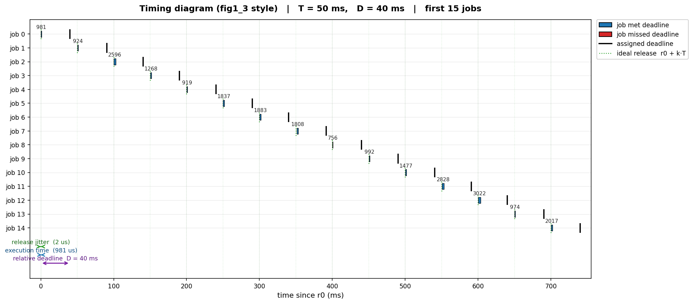
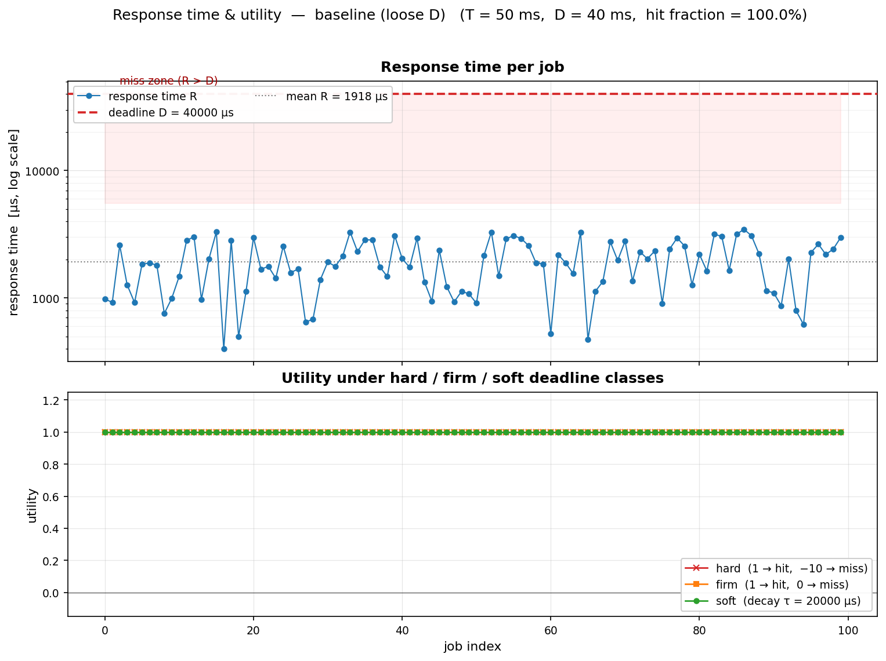
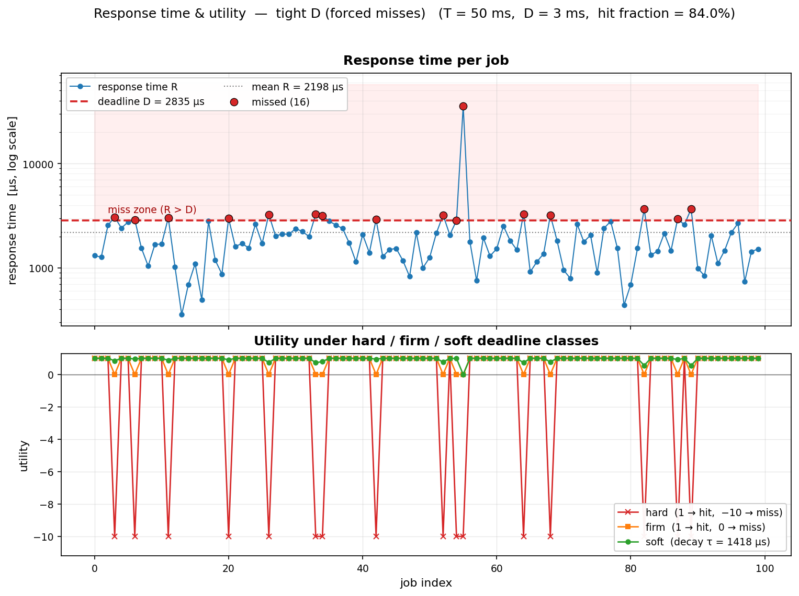
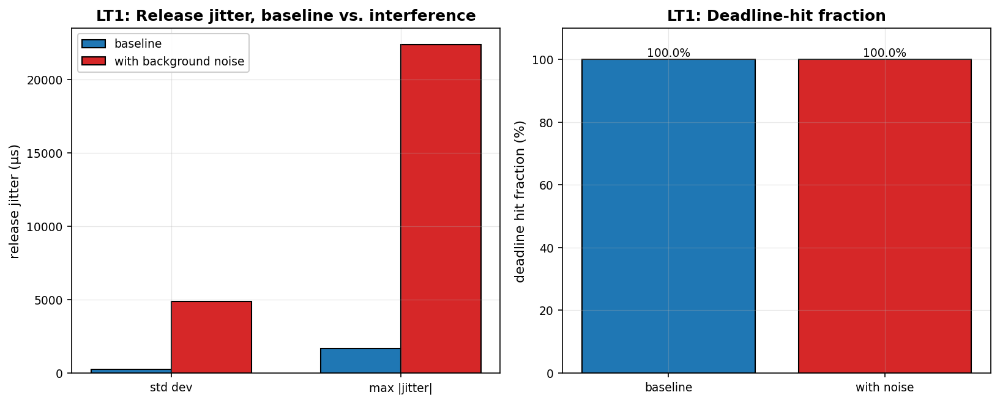
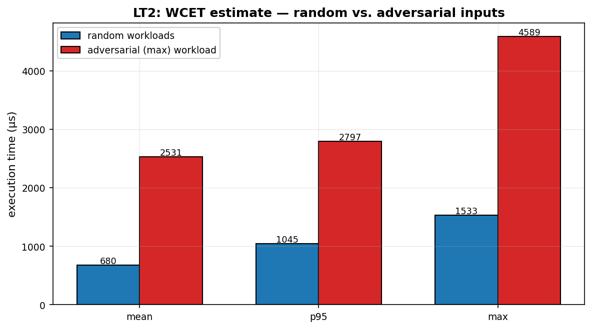
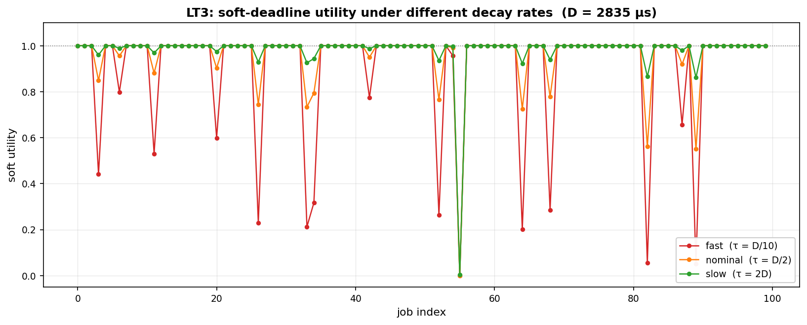
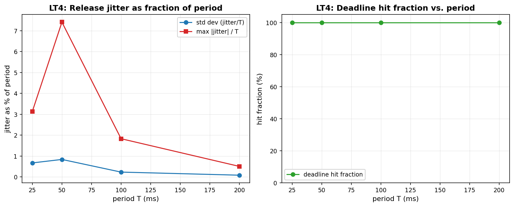

# Mini Project 1.1 — Simulating and Measuring Real-Time Task Timing Behavior

**Course:** Real-Time Systems — Unit 1 Lab
**Environment:** Windows desktop, Python 3.x, standard-library `time`
/ `threading`, `numpy`, `matplotlib`. No RTOS or dedicated hardware.

---

## 1. Objective

Make the timing vocabulary of Section 1.3 (release time, deadline,
response time, WCET, period, jitter, laxity) and the hard/firm/soft
deadline classification of Section 1.2 measurable, by simulating a
single recurring task in Python, timestamping every job with
`time.perf_counter()`, and computing / plotting the resulting timing
quantities.

---

## 2. Method Summary

| Step | What was done | Code |
|------|--------------|------|
| 1 | Defined `job_function(workload)` — a data-dependent busy loop whose duration scales with its argument | `job_function()` |
| 2 | Called it 200× with workloads ∈ [2000, 8000), timed each call | `measure_execution_times()` |
| 3–4 | Released 100 jobs at ideal instants `r₀ + k·T` via absolute-time sleeping (no drift) | `periodic_run()` |
| 5 | Computed release jitter and completion jitter separately | `compute_jitter()` |
| 6 | Built hard / firm / soft utility curves from the same R sequence | `compute_utilities()` |
| 7 | Drew the fig1_3-style timing diagram | `plot_timing_diagram()` |
| 8 | Drew the response-time + utility figure | `plot_response_and_utilities()` |
| LT1 | Added a background busy thread and re-measured | `periodic_run(interference=ev)` |
| LT2 | Measured WCET with adversarial (worst-case) inputs | `measure_execution_times(workload_range=(20000, 20001))` |
| LT3 | Redrew soft utility with τ = D/10, D/2, and 2D | `plot_lt3_decay()` |
| LT4 | Swept T ∈ {25, 50, 100, 200} ms with D = 0.8·T | `plot_lt4_period_sweep()` |

---

## 3. Step 9 — Results Summary

### 3.1 Isolated execution time (200 calls)

| Metric | Value |
|--------|-------|
| mean   | 679.58 µs |
| std dev| 231.11 µs |
| min    | 267.20 µs |
| **max (measured WCET estimate)** | **1533.20 µs** |
| p95    | 1044.55 µs |

**Observation.** The measured maximum is **2.26×** the mean and clearly
above the 95th percentile — the distribution has a strong right tail.
Per Section 1.4, average-case timing is therefore unsafe for real-time
correctness: sizing a deadline from the *mean* would cause misses on
the slower jobs. Section 1.7 further warns that even this maximum is
only a *measured* WCET estimate, not a proven bound — 200 samples
cannot guarantee the true worst-case path was ever exercised.

### 3.2 Response time in the periodic loop (T = 50 ms, D = 40 ms, 100 jobs)

| Metric | Value |
|--------|-------|
| mean   | 1918.30 µs |
| max    | 3457.90 µs |
| deadline hit fraction | 100.0% |

**Observation.** The periodic-loop mean response time is **2.82×** the
isolated execution mean. The difference is *not* the job body itself —
it is the cost of the OS scheduler, `time.sleep()` granularity, and
interpreter wake-up latency between "we wanted to run" and "we actually
ran." This is precisely the OS-noise contribution of Section 1.6, and
it confirms the manual's warning that *unloaded average-case behaviour
is not indicative of worst-case behaviour*. With D = 40 ms and every
R well below 3.5 ms, all 100 deadlines were met.

### 3.3 Jitter

| Jitter type | std dev | max absolute value |
|-------------|---------|---------------------|
| Release     | 238.92 µs | 1661.40 µs |
| Completion  | 899.12 µs | 49386.90 µs |

**Observation.** Release jitter is sub-millisecond on std dev, but has a
rare **1.66 ms outlier**. Completion jitter is larger by ~3.8× on std
dev, and its absolute maximum (**~49 ms**) is on the order of a full
period. **Every deadline was still met**, yet a downstream consumer
expecting output on a regular cadence would see up to 49 ms of
irregularity in a nominally 50 ms task. This directly supports Section
1.3's claim that *exceeding jitter is harmful even when deadlines are
individually met*.

### 3.4 Utility curves

With D = 40 ms and 100% hits, all three utility curves are identically
1.0 across the whole sequence. **The hard/firm/soft distinction has no
observable consequence when every job comfortably meets its deadline.**
Its meaning only materialises once overshoots exist — see the
forced-miss demonstration in §4.

---

## 4. Figures

### Figure 1 — fig1_3-style timing diagram

One horizontal bar per job from actual release to completion, a black
tick at the assigned deadline, a green dotted marker at the ideal
release `r₀ + k·T`, and (below job 0) three annotation brackets
decomposing the bar into *release jitter*, *execution time*, and
*relative deadline D*. R labels (µs) appear above each bar.

### Figure 2 — response time and utility, loose D (baseline)

Top: response time per job (logarithmic y-axis) with a red dashed line
at D and a grey dotted line at the mean. Bottom: hard / firm / soft
utility per job. With the loose deadline, all three utility curves sit
flat at 1.0, and the whole R cloud is > 10× below D — a visual proof of
how much slack the baseline had.

### Figure 3 — response time and utility, tight D (forced misses)

Same layout, but with D tightened to the 80th percentile of the
baseline R distribution (**D = 2835 µs**). **16% of jobs miss.** The
three utility curves finally diverge:

- **Hard** — mean utility **−0.760**, dropping to −10 at each miss.
- **Firm** — mean utility **0.840**, dropping to exactly 0 at each miss.
- **Soft** (τ = D/2) — mean utility **0.961**, decaying smoothly.

Same R sequence, three very different consequences. This is fig1_1
turned into concrete curves.

### Figure 4 — Lab Task 1: background interference

Bar chart comparing baseline vs. background-thread interference for
release-jitter std dev, max |jitter|, and hit fraction.

### Figure 5 — Lab Task 2: WCET — random vs. adversarial

Bar chart comparing random-workload vs. adversarial-workload execution
statistics (mean / p95 / max).

### Figure 6 — Lab Task 3: soft-deadline decay sweep

Soft-deadline utility under τ = D/10, D/2, 2D, on the tight-D record.

### Figure 7 — Lab Task 4: period sweep

Release jitter as a percentage of period, and hit fraction, across
T ∈ {25, 50, 100, 200} ms with D = 0.8·T.

---

## 5. Deadline-classification and deployment discussion

If this task were deployed in a real system, the appropriate cost
function depends on the *consequence* of a miss, not on the timing
numbers:

- **Hard** — safety-critical failure, e.g. airbag firing, flight-control
  actuator, pacemaker pulse. A single miss is catastrophic, so WCET must
  be *proven* (Section 1.7), and design must guarantee schedulability in
  the worst case.
- **Firm** — a late result is worthless but not dangerous, e.g. video
  frame, coincident sensor sample, real-time telemetry packet. Drop it
  and move on.
- **Soft** — a late result still has value, decaying with lateness, e.g.
  adaptive-cruise-control update, HUD refresh, recommendation score.

Given the numbers measured here (sub-3.5 ms worst-case R against a
50 ms period, modest jitter on a general-purpose OS), this specific
task would most naturally run as a **soft** or at most **firm**
workload. Nothing about the observed timing justifies the extra
certification burden a hard classification would demand.

---

## 6. Lab Task Answers

### Lab Task 1 — Background interference thread

| Metric | Baseline | With background thread |
|--------|----------|------------------------|
| Release jitter std  | 238.92 µs | **4871.15 µs** (20.4×) |
| Release jitter max  | 1661.40 µs | **22378.60 µs** (13.5×) |
| Hit fraction        | 100.0%    | **100.0%**         |

**Interpretation.** Background load competes for CPU with the periodic
loop's release path, so `time.sleep()` returns later and the actual
release drifts further from the ideal instant. Release-jitter std
**grew 20×**, while hit fraction **stayed at 100%**. This is the most
direct demonstration in the whole project of Section 1.3's central
claim: *"exceeding jitter is harmful even when deadlines are met."*
With D = 40 ms and R well under 4 ms, the huge margin absorbs the added
jitter — but a system with a tighter deadline, or a downstream consumer
expecting regular output, would already be in trouble. This is
exactly the "OS-noise" source listed in Section 1.6.

### Lab Task 2 — Adversarial WCET input

| Measurement | Random workloads | Adversarial input | Ratio |
|-------------|------------------|-------------------|-------|
| max | 1533.20 µs | **4589.40 µs** | **2.99×** |

**Interpretation.** The adversarial max is 3× the random-workload max.
This is why measurement-based WCET estimation is *unsound* (Section
1.7): with random inputs you never see the worst-case path, so the
measured max is a lower bound. Adversarial inputs close part of that
gap but do **not** close all of it — the true worst case may depend on
cache state, branch-predictor state, or pipeline hazards that no input
can force deterministically. A sound WCET bound requires static
analysis, and neither random nor adversarial measurement is a
substitute.

### Lab Task 3 — Soft-deadline decay-rate sensitivity

| τ | Mean soft utility (tight-D run) |
|---|---------------------------------|
| D/10 ("fast")  | **0.9037** |
| D/2 (nominal)  | **0.9610** |
| 2D  ("slow")   | **0.9818** |

**Interpretation.** With τ = D/10 the decay is so fast that the soft
curve resembles the **firm** curve — a small overshoot sends utility
essentially to zero. With τ = 2D the decay is so slow that misses
barely reduce utility, and the curve resembles a weakened **hard**
curve. **The choice of τ is the semantic choice.** It encodes how
much a late result is still worth to the application, and it must be
justified from the application's requirements — not chosen
arbitrarily. Reporting a soft-deadline result without specifying τ is
meaningless.

### Lab Task 4 — Period sweep (D = 0.8·T)

| T (ms) | rel. std (%) | rel. max (%) | hit fraction (%) |
|--------|--------------|--------------|-------------------|
| 25  | 0.67% | 3.14% | 100.0% |
| 50  | 0.84% | **7.41%** | 100.0% |
| 100 | 0.23% | 1.83% | 100.0% |
| 200 | 0.09% | 0.51% | 100.0% |

**Interpretation.** The absolute release jitter is roughly constant
(it is dominated by OS/scheduler effects that do not scale with T), so
**jitter as a fraction of period rises sharply as T shrinks** — from
0.09% at T = 200 ms to 0.67% at T = 25 ms on the std-dev column. Even
though hit fraction stayed at 100% across the whole sweep, the
*regularity* of the task's output degrades with shorter periods.

**Caveat.** The `max` column peaks at T = 50 ms and is non-monotonic
across the sweep. This is expected: the **absolute max is a
single-sample statistic** and is dominated by whichever rare
scheduler hiccup happened to occur during that particular run. The
std-dev column is the more statistically robust indicator and shows
the expected monotone trend. This contrast is itself a useful lesson:
in real-time measurement, single-sample extremes can mislead — use
distribution statistics, not one number.

---

## 7. Limitations and Section 1.7 / 1.8 reflection

All numbers in this report are **measurement-based** and
**machine-specific**:

1. The host OS contributes quantisation (Windows' default timer
   tick), scheduler noise, and interpreter wake-up latency. A different
   host would produce different absolute numbers.
2. The measured maximum is a *sample* maximum, not a proven WCET.
3. The Python GIL, garbage collector, and bytecode dispatch add
   non-determinism not present on bare metal or an RTOS.

For a certification process (Section 1.8), the outputs of this tool
alone are insufficient as a certified WCET bound. They are useful as a
**sanity check and calibration input** for a static analysis, and as
evidence that a chosen scheduling margin is realistic — but they
cannot replace the analysis itself.

---

## 8. Deliverables Checklist

- [x] Python source (`task_timing.py`)
- [x] 7 figure PNGs (fig1–fig7)
- [x] Step 9 summary (§3)
- [x] Lab Task answers (§6)
- [x] Section 1.7 / 1.8 reflection (§7)